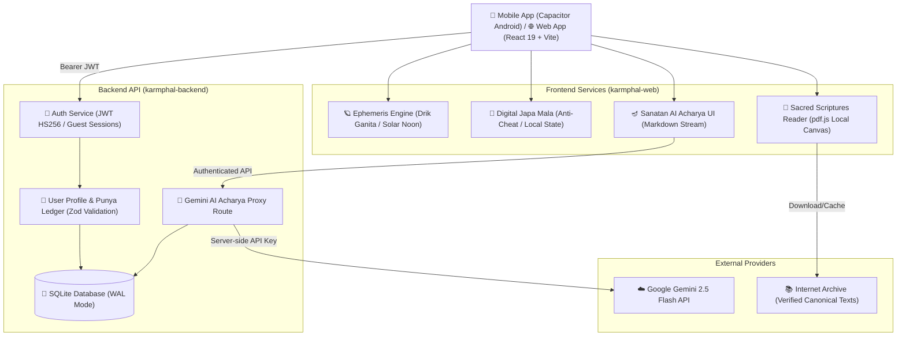

# ॐ कर्मफल (Karmphal)

> **Vedic Ephemeris, Dharmik Sadhana, Astrological Insights & Sanatan Life-Management System**  
> प्रामाणिक वैदिक काल-गणना, सनातन शास्त्र सम्मत साधना एवं आध्यात्मिक जीवन प्रबन्धन

---

## 🏛️ वास्तुशिल्प एवं वास्तुकला (System Architecture)

Karmphal को एक आधुनिक, सुरक्षित और प्रदर्शन-उन्मुख (high-performance) त्रि-स्तरीय (three-tier) आर्किटेक्चर पर निर्मित किया गया है:



---

## 📂 प्रोजेक्ट संरचना (Repository Structure)

```text
karmphal/
├── karmphal-web/                 # React 19 + Vite 8 फ्रंटएंड एवं कैपेसिटर ऍप
│   ├── src/
│   │   ├── assets/               # अनुकूलित WebP & AVIF छवियां (सभी < 100KB)
│   │   ├── components/           # UI घटक (Navbar, PDFReader, ProfileModal, JapaMala)
│   │   ├── context/              # पृथक React Contexts (Profile, Japa, Task, Chat, Toast)
│   │   ├── sections/             # मुख्य अनुभाग (Guru, Gyan, Sadhana, Jyotish, Karma)
│   │   └── services/             # खगोलीय गणना, ऑडियो, भाषा, एवं स्टोरेज सेवाएँ
│   ├── scripts/
│   │   ├── optimize-images.mjs   # Sharp आधारित इमेज ऑप्टिमाइज़ेशन पाइपलाइन
│   │   └── verify_library_books.mjs # शास्त्र लाइब्रेरी URL सत्यापन स्क्रिप्ट
│   ├── tests/                    # Vitest/Node आधारित परफॉरमेंस एवं यूनिट टेस्ट
│   └── android/                  # मूल Android Capacitor प्रोजेक्ट
│
├── karmphal-backend/             # Node.js + Express सिक्योर बैकएंड API
│   ├── routes/                   # Auth, User, AI Acharya एवं Sync रूट्स
│   ├── schemas/                  # Zod स्कीमा वेलिडेशन (Strict validation)
│   ├── middleware/               # JWT सत्यापन, रेट लिमिटिंग, हेलमेट
│   └── smoke.test.js             # बैकएंड ऑटोमेटेड स्मोक टेस्ट
│
├── assets-src/                   # मूल उच्च-रिज़ॉल्यूशन छवियां (बिल्ड से बाहर)
├── DEPLOYMENT.md                 # क्लाउड एवं एंड्रॉइड डिप्लॉयमेंट गाइड
└── README.md                     # सिस्टम आर्किटेक्चर एवं दस्तावेज़ीकरण
```

---

## 🛠️ मुख्य घटक एवं मॉड्यूल विवरण

### 1. `karmphal-web` (क्लाइंट एप्लिकेशन)
- **द्रिक-पञ्चाङ्ग व सौर गणना ([`ephemerisEngine.js`](file:///c:/Users/rajen/AndroidStudioProjects/karmphal/karmphal-web/src/services/ephemerisEngine.js))**:
  - उच्च-परिशुद्धता लहिरी अयनांश गणना।
  - वास्तविक अक्षांश/देशांतर आधारित सौर सूर्योदय, सूर्यास्त, ब्रह्म मुहूर्त, अभिजित मुहूर्त व राहु काल।
  - दिनांक स्तर पर मेमोइज़ेशन (`useMemo`), जिससे जप माला मनके चलाने पर 0 री-रेंडर्स होते हैं।
  - एकल 1-मिनट का टाइमर रेंडर पाथ से बाहर इन्ट्रा-डे समाप्ति समय की गणना करता है।
- **अक्षर-वेग रक्षक जप माला ([`DigitalJapaMala.jsx`](file:///c:/Users/rajen/AndroidStudioProjects/karmphal/karmphal-web/src/components/SadhanaGamification/DigitalJapaMala.jsx))**:
  - 108 मनकों का डिजिटल जप।
  - 250ms से तीव्र या रोबोटिक ऑटो-क्लिकर टैप्स को स्वतः अस्वीकार करने वाला एंटी-चीट इंजन।
  - स्थानीय `useState` काउंटर और 2-सेकंड का डीबाउंस्ड स्टोरेज परसिस्टेंस।
- **शास्त्र ई-पुस्तकालय ([`PDFReader.jsx`](file:///c:/Users/rajen/AndroidStudioProjects/karmphal/karmphal-web/src/components/PDFReader.jsx))**:
  - स्थानीय बंडल `pdfjs-dist` कैनवास रेंडरिंग (नो आईफ्रेम, नो वेबव्यू क्रैश)।
  - 3-ब्लॉब LRU कैशिंग एवं यूआरएल निष्कासन (Zero memory leak)।
- **संवाद आचार्य चैट ([`SanatanAIAcharya.jsx`](file:///c:/Users/rajen/AndroidStudioProjects/karmphal/karmphal-web/src/components/TheologicalChatbot/SanatanAIAcharya.jsx))**:
  - सुरक्षित बैकएंड प्रॉक्सी के माध्यम से जेमिनी AI से संवाद।
  - `react-markdown` + `remark-gfm` + `rehype-sanitize` द्वारा शुद्ध देवनागरी/संस्कृत रेंडरिंग।
  - **शास्त्र-सम्मत आध्यात्मिक परामर्श एवं संकट सुरक्षा (Scripture-Grounded Counseling & Crisis Layer)**:
    - प्रामाणिक श्लोकों के आधार पर ग्राउंडेड उत्तर और उद्धरण (Citations)।
    - निरंतर दृश्यमान (persistent) संकट परामर्श डिस्क्लेमर तथा प्रत्यक्ष 'कॉल-टू-हेल्पलाइन' बटन्स (KIRAN: `1800-599-0019`, Tele-MANAS: `14416`, `112`)।
    - ऑफ़लाइन या नेटवर्क त्रुटि होने पर पारदर्शी और स्पष्ट तकनीकी सन्देश (कोई भ्रामक आध्यात्मिक उत्तर नहीं)।
  - सेशन एवं सर्वर-साइड डेटाबेस हिस्ट्री परसिस्टेंस।

### 2. `karmphal-backend` (सुरक्षित एवं सुदृढ़ API सर्वर)
- **शास्त्र-आधारित आध्यात्मिक काउंसलिंग इंजन ([`counseling.service.js`](file:///c:/Users/rajen/AndroidStudioProjects/karmphal/karmphal-backend/services/counseling.service.js))**:
  - **प्रामाणिक शास्त्र ज्ञानकोश (Curated Scripture Knowledge Base)**: 51 गीता प्रेस एवं उपनिषद् श्लोक (`ScriptureVerses` तालिका) जो चिंता, शोक, धर्मसंकट, क्रोध, आत्म-हानि जोखिम आदि टैग्स से अनुक्रमित हैं।
  - **तीव्र इन-प्रोसेस भावना व मंतव्य वर्गीकरण (Emotion & Intent Classifier)**: शून्य AI कॉल ओवरहेड के साथ 1-10ms में यूज़र संदेश का वर्गीकरण (`anxiety/despair`, `grief`, `duty-conflict`, `anger/injustice`, `self-harm-risk`, `general-question`)।
  - **एंटी-मतिभ्रम सत्यापन (Anti-Hallucination Citation Validator)**: जेमिनी द्वारा उद्धृत श्लोक सन्दर्भों का सत्यापन कर काल्पनिक या अप्रमाणित श्लोक संख्याओं को स्वतः निष्कासित (strip/sanitize) करना।
  - **अनिवार्य संकट सुरक्षा स्तर (Critical Crisis Safety Layer)**: आत्म-हानि, अवसाद या निराशा के प्रत्यक्ष/परोक्ष/काल्पनिक संकेतों पर स्वतः आपातकालीन राष्ट्रीय मानसिक स्वास्थ्य हेल्पलाइन (KIRAN `1800-599-0019`, Tele-MANAS `14416`, Vandrevala, `112`) जोड़ना।
  - **आत्मिक यात्रा एवं पुण्य संचय (Wellbeing Journey Ledger)**: प्रत्येक आध्यात्मिक संवाद चिंतन पर साधक को +5 पुण्य अंक और निजी `WellbeingJourneys` इतिहास।
- **प्रमाणीकरण (Authentication)**:
  - बिना किसी बाहरी पासवर्ड निर्भरता के तात्कालिक गेस्ट सेशन एवं JWT टोकन जेनरेशन (HS256, 30-day expiry)।
  - रिफ्रेश टोकन रोटेशन (SHA-256 हैशेड स्टोरेज) और ऑटो-रिफ्रेश सिंगल-फ्लाइट मैकेनिज्म।
  - संपूर्ण सुरक्षित रूट्स पर स्ट्रिक्ट बियरर टोकन सत्यापन।
- **डेटाबेस (SQLite WAL & Composite Indexing)**:
  - SQLite Write-Ahead Logging (WAL) मोड, busy_timeout (5000ms), और विदेशी कुंजी (foreign keys) प्रवर्तन।
  - माइग्रेशन प्रणाली (001-005) के तहत साधक प्रोफ़ाइल, नित्य पुण्य लेज़र, जप सांख्यिकी, और वार्तालाप इतिहास पर संयुक्त अनुक्रमणिका (Composite Indexes) जिससे सभी मुख्य क्वेरी शून्य फुल-टेबल-स्कैन के साथ O(1)/O(log N) गति से निष्पादित होती हैं।
- **AI प्रॉक्सी एवं सुरक्षा**:
  - `GEMINI_API_KEY` को सर्वर-साइड गुप्त रखा जाता है (क्लाइंट APK/Web में कभी एक्सपोज़ नहीं होता)।
  - प्रति-यूज़र एवं प्रति-आईपी दर सीमा (Rate Limiting) और दैनिक कोटा (Daily Quota) सुरक्षा।
  - प्रॉम्प्ट इंजेक्शन सुरक्षा (Prompt Injection Guardrails) तथा 10MB OCR पार्सर सीमा।
- **उत्पादन लचीलापन (Production Resilience)**:
  - `/health` और `/ready` जांच (Liveness & Readiness Probes)।
  - अनुग्रहयुक्त शटडाउन (Graceful Shutdown) SIGTERM/SIGINT पर WAL चेकपॉइंटिंग के साथ।
  - स्वचालित ऑनलाइन बैकअप स्क्रिप्ट (`npm run backup`) 7-बैकअप अवधारण नीति (retention policy) के साथ।

---

## 🚀 स्थानीय विकास (Local Development)

### आवश्यकताएं
- **Node.js**: v18.0.0 या उच्चतर
- **npm**: v9.0.0 या उच्चतर

### 1. निर्भरताएं स्थापित करें
```bash
# रूट फोल्डर में
npm install

# बैकएंड फोल्डर में
cd karmphal-backend
npm install
cd ..

# वेब फोल्डर में
cd karmphal-web
npm install
cd ..
```

### 2. विकास सर्वर चलाएं
```bash
# दोनों फ्रंटएंड और बैकएंड एक साथ चलाने हेतु:
npm run dev

# अथवा अलग-अलग टर्मिनलों में:
npm run dev:backend   # Express API on http://localhost:5000
npm run dev:web       # Vite Dev Server on http://localhost:5173
```

### 3. परीक्षण (Testing) एवं लिंटिंग (Linting)
```bash
# बैकएंड स्मोक टेस्ट:
npm test

# वेब यूनिट व परफॉरमेंस टेस्ट सूट:
cd karmphal-web
npm test

# कोड गुणवत्ता व लिंटर जांच:
npx oxlint
```

---

## 📱 मोबाइल बिल्ड (Capacitor Android)

उत्पादन वातावरण के लिए एंड्रॉइड एपीके (APK) अथवा बंडल (AAB) तैयार करने हेतु:

```bash
cd karmphal-web

# वेब बंडल तैयार करें
npm run build

# नेटिव एंड्रॉइड प्रोजेक्ट में सिंक करें
npx cap sync android

# एंड्रॉइड स्टूडियो में खोलें
npx cap open android
```

---

## 💾 डेटाबेस बैकअप एवं पुनर्स्थापना (Backup & Restore Procedure)

### ऑनलाइन बैकअप (Zero-downtime Online Backup)
बैकएंड में `sqlite3.backup()` API का उपयोग करके बिना रीड/राइट ब्लॉक किए लाइव बैकअप लिया जाता है:
```bash
cd karmphal-backend
npm run backup
```
- बैकअप फ़ाइलें `karmphal-backend/backups/karmphal-backup-YYYY-MM-DDTHH-mm-ss.db` में संग्रहीत होती हैं।
- अवधारण नीति (Retention Policy): नवीनतम 7 बैकअप सुरक्षित रखे जाते हैं, पुराने बैकअप स्वतः हटा दिए जाते हैं।
- इसे `cron` या सिस्टम टाइमर द्वारा स्वचालित किया जा सकता है (उदा. दैनिक रात्रि २ बजे):
  `0 2 * * * cd /path/to/karmphal-backend && npm run backup >> /var/log/karmphal-backup.log 2>&1`

### पुनर्स्थापना प्रक्रिया (Disaster Recovery & Restore)
1. बैकएंड सेवा को सुरक्षित रोकें: `systemctl stop karmphal` या `pm2 stop karmphal`
2. बैकअप फ़ाइल की सत्यनिष्ठा (Integrity) जांचें:
   ```bash
   sqlite3 backups/karmphal-backup-YYYY-MM-DDTHH-mm-ss.db "PRAGMA integrity_check;"
   # आउटपुट: 'ok'
   ```
3. मुख्य डेटाबेस फ़ाइल को प्रतिस्थापित करें:
   ```bash
   cp backups/karmphal-backup-YYYY-MM-DDTHH-mm-ss.db data/karmphal.db
   rm -f data/karmphal.db-wal data/karmphal.db-shm
   ```
4. बैकएंड सेवा पुनः प्रारम्भ करें एवं रेडीनेस जांचें:
   ```bash
   curl http://localhost:5000/ready
   # आउटपुट: {"status":"ready","database":"connected"}
   ```


विस्तृत उत्पादन परिनियोजन (Production Deployment) निर्देशों के लिए [`DEPLOYMENT.md`](file:///c:/Users/rajen/AndroidStudioProjects/karmphal/DEPLOYMENT.md) देखें।

---

## 🔮 भविष्य की कार्ययोजना एवं शोध दिशाएं (Future Roadmap & Research Directions)

शोध पत्र में उल्लिखित निम्नलिखित उन्नत अवधारणाएं वर्तमान चरण के दायरे से बाहर (Out of Scope) रखी गई हैं, ताकि वर्तमान स्टैक हल्का, तेज और बाह्य निर्भरताओं से मुक्त रहे। इन्हें भविष्य के रिलीज हेतु सूचीबद्ध किया गया है:

1. **वितरित माइक्रोसेवा ट्रांजिशन (Distributed Microservice Architecture):**
   - बड़े पैमाने (Multi-region scale) पर इन-प्रोसेस SQLite को PostgreSQL अथवा MongoDB क्लस्टर द्वारा प्रतिस्थापित करना।
2. **उन्नत स्थानीय एनएलपी एवं वेक्टर एम्बेडिंग्स (On-Premise Indic NLP & Vector Search):**
   - वर्तमान तीव्र रेगेक्स/कीवर्ड वर्गीकरण के स्थान पर हल्के, ऑन-प्रिमाइसेस इंडिक मॉडल (जैसे IndicBERT या BGE-M3) और SQLite vss / pgvector का उपयोग।
3. **बायोमेट्रिक एवं वेयरेबल इंटीग्रेशन (IoT & Wearable Physiological Stress Streaming):**
   - स्मार्ट वॉच एवं स्मार्ट रिंग्स के माध्यम से रीयल-टाइम हृदय गति परिवर्तनशीलता (HRV - Heart Rate Variability) डेटा प्राप्त कर आध्यात्मिक काउंसलिंग में तनाव इनपुट के रूप में उपयोग करना।
4. **इमर्सिव आध्यात्मिक वीआर वातावरण (WebXR & Immersive VR Dhyana):**
   - निर्देशित ध्यान (Guided Dhyana), वैदिक अनुष्ठान एवं मन्दिर परिक्रमा हेतु WebXR / 3D वर्चुअल रियलिटी परिवेश।
